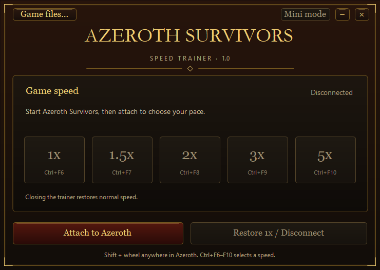
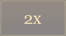

# Azeroth Survivors Speed Trainer

A portable Windows trainer with a game-inspired interface, speed presets, keyboard shortcuts and a small floating mode. It works only with Azeroth Survivors and does not require Cheat Engine.



[Download the latest release](https://github.com/dreamion08/azeroth-survivors-speed-trainer/releases/latest)

## Install

1. Download **Azeroth-Survivors-Speed-Trainer-v1.0.0-win-x64.zip** from the release page.
2. Extract the ZIP to any folder. Keep the executable and its DLL together.
3. Start Azeroth Survivors normally, then run the trainer executable.
4. Click **Attach** to detect and connect to the running game. To select an installation first, use **Game files…**.
5. Choose a speed.

**Game files… selects an installation; it does not start the game.** Attachment requires the running game to match that selection. Without an explicit selection, Attach detects the running game each time.

Requires 64-bit Windows. .NET Framework 4.8 is recommended. No installer or game-file changes are required.

## Controls

Use the preset buttons or keyboard shortcuts while Azeroth Survivors or the trainer has focus. Hold **Shift** and scroll the mouse wheel up or down to change speed without pointing at a particular control.

| Speed | Shortcut |
| --- | --- |
| 1x, normal speed | Ctrl+F6 |
| 1.5x | Ctrl+F7 |
| 2x | Ctrl+F8 |
| 3x | Ctrl+F9 |
| 5x | Ctrl+F10 |

Use **Mini** for a small, draggable window that stays on top at 50% opacity. Double-click it or press **Esc** while it has focus to return to the full window.



Closing the trainer requests **1x** speed. If the trainer crashes or stops responding, its in-game module restores 1x after approximately two seconds, provided the game can run its worker thread. Restart Azeroth Survivors to fully unload the module.

## Game updates

The trainer checks the selected game and its timing imports before attaching. Compatible builds can be accepted without a fixed executable fingerprint. This does not guarantee support for every future update: the trainer refuses builds that fail its checks, and changes to the engine may require a trainer update.

If attachment fails, restart the game and trainer, confirm the selected installation, and use matching privilege levels. If either application is running as administrator, the other may need the same privileges.

## Limits

- This is a conventional trainer that loads a timing DLL into the selected Azeroth Survivors process. It does not hide itself or bypass anti-cheat. Compatibility alongside Aion 2 or other protected games is unverified.
- Local single-player use is the intended scope. Co-op and network timing are not verified.
- Timing changes can also affect menus, animations or internal timeouts. Frame rate, engine delta limits and independently timed systems may prevent the requested speed from matching actual gameplay speed exactly.
- The release is unsigned. It does not install a driver, change the Windows clock, modify game files or edit saves. Do not disable security software to make it run.

## Build from source

The release ZIP contains the ready-to-run app. For source builds, clone or download this repository first.

Install Visual Studio C++ x64 Build Tools with a Windows SDK. Use PowerShell and the Windows .NET Framework compiler, then run this command from the repository folder:

```powershell
.\source\Build.ps1
```

The script builds the trainer and native module into `dist`, runs the timing tests and generates build metadata. Tests use a dedicated test process rather than a running game.

The test suite includes selected-path checks, all five timing ratios, mini-mode/input behavior, and loading the production DLL into an isolated test host in a folder with spaces and Unicode. It also verifies that a mismatched path is rejected. Live gameplay and anti-cheat coexistence are not certified by these tests.

## License

The trainer code and its original interface are available under the [MIT license](LICENSE). This project does not distribute Azeroth Survivors game assets and is not an official game release.
